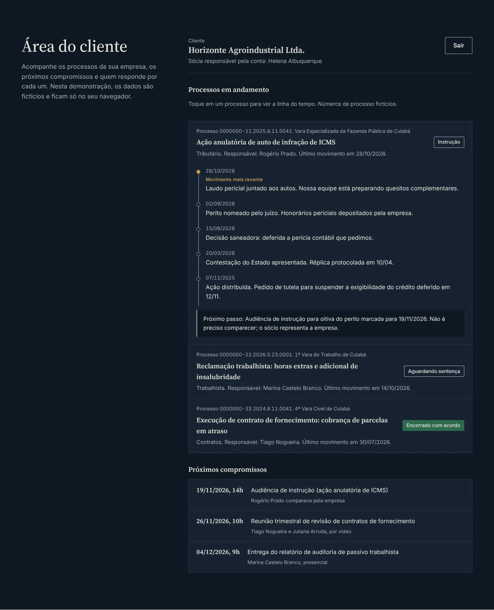
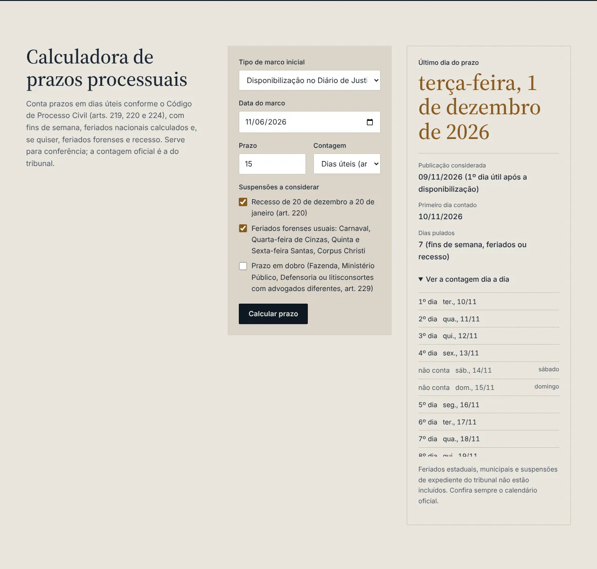
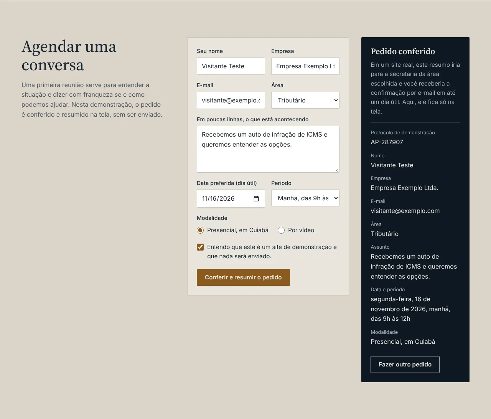
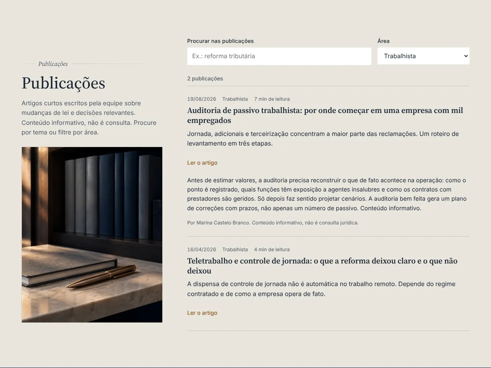

# Albuquerque Prado Advogados (site de demonstração)

Eu sou o Rodrigo Jr, da [Mil e Uma Linhas!](https://mileumalinhas.com.br), em Cuiabá. Este é um site que fiz para mostrar como fica o site de um escritório de advocacia de porte médio ou grande: várias áreas, vários sócios, uma área do cliente que mostra o andamento dos processos e ferramentas que o visitante usa de verdade, como uma calculadora de prazos processuais.

**Tudo aqui é fictício.** A banca Albuquerque Prado não existe. Os sócios, os números de OAB, os processos, o cliente, o endereço, o telefone e as publicações foram inventados para a demonstração. Nada é enviado, cobrado ou guardado fora do seu navegador.

Endereço publicado: https://toshiro01001.github.io/escritorio-advocacia/


## O que o site faz

Para quem não é da área de tecnologia: é um site de uma página só, com as seções que um escritório de advocacia precisa, e com cinco coisas que funcionam de verdade na tela.

1. **Equipe com filtro e busca.** Escolha uma área (Empresarial, Tributário, Trabalhista, Contratos) ou digite um nome, cargo ou tema; a lista de catorze advogados se ajusta na hora.
2. **Área do cliente.** Entre com o usuário `empresa.demo` e a senha `acesso2026` (eles aparecem na tela de propósito) e veja três processos fictícios de uma empresa cliente, cada um com uma linha do tempo de movimentos, o próximo passo e os próximos compromissos.
3. **Calculadora de prazos processuais.** Informe a data da disponibilização no Diário eletrônico (ou da publicação, ou da intimação), o número de dias e a forma de contagem; o site aplica as regras do Código de Processo Civil e devolve o último dia do prazo, com a contagem dia a dia e o motivo de cada dia pulado.
4. **Agendamento de reunião.** Um formulário que confere cada campo (inclusive se a data cai em dia útil) e mostra um resumo do pedido na tela, sem enviar nada.
5. **Publicações com busca.** Oito artigos curtos, com busca por texto e filtro por área, e o texto completo em um bloco que abre e fecha.

| Equipe | Área do cliente | Prazos |
| --- | --- | --- |
|  |  |  |

| Reunião | Publicações |
| --- | --- |
|  |  |

As mesmas funções no celular estão em `docs/funcao-*-iphone13.webp`.

## Como usar, em passos

1. Abra o endereço publicado (ou rode localmente, veja abaixo).
2. Role até **Equipe** e toque em "Tributário"; depois digite "reforma" na busca.
3. Role até **Área do cliente**, digite `empresa.demo` e `acesso2026` e toque em "Entrar". Toque em um processo para abrir a linha do tempo. "Sair" encerra.
4. Em **Calculadora de prazos**, deixe "Disponibilização no Diário de Justiça eletrônico", escolha uma data e um número de dias e toque em "Calcular prazo". Abra "Ver a contagem dia a dia".
5. Em **Agendar uma conversa**, preencha o formulário e toque em "Conferir e resumir o pedido". Tente deixar um campo vazio para ver a validação.
6. Em **Publicações**, digite uma palavra ou filtre por área, e toque em "Ler o artigo".

## Identidade visual, em resumo

O estudo completo está em [`docs/identidade.md`](docs/identidade.md). O ponto de partida foi a diferença entre um escritório grande e um advogado que atende sozinho: aqui o site precisa parecer um edifício institucional, não uma mesa de trabalho. Por isso fugi da balança, do mármore e do dourado.

- **Paleta:** Noite `#0E1823` (preto-azulado profundo, fundo do hero, da área do cliente e do rodapé), Calcário `#E9E5DD` e Calcário escuro `#DAD4C8` (pedra clara, fundos das seções de conteúdo), Ardósia `#1B2633` (texto), Névoa `#A7B0BA` (texto secundário sobre escuro), Bronze `#8A5A20` / `#C99A55` (um acento por tela: a linha do hero, o filtro escolhido, a data final do prazo, o botão principal da reunião) e Verde-garrafa `#2E6B4E` só para "concluído".
- **Fontes:** Source Serif 4 (títulos, nomes, números grandes, citação) e Inter (corpo, formulários, tabelas), ambas variáveis, servidas da pasta `fonts/` com licença SIL OFL. Nenhuma fonte externa.
- **Forma:** cantos de 2 px, divisórias de 1 px, blocos largos alternando escuro e claro como andares de um edifício; títulos à esquerda em 4 colunas e conteúdo em 8.
- **Imagem forte:** uma fotografia em proporção 3:2 no hero (`img/hero.webp`), gerada por IA no Canva (ilustrativa, não é uma obra real). O prompt usado está em `docs/identidade.md`.
- **Movimento:** só a abertura do hero (título, foto e linha de bronze) e respostas a ações. Com "reduzir movimento" ligado no aparelho, nada se mexe.

## Como funciona por dentro

Tudo roda no navegador. A lista da equipe, os processos e as publicações estão escritos como dados dentro de `js/app.js`; o JavaScript monta os elementos na tela e o filtro só esconde e mostra. O login compara o que foi digitado com o usuário e a senha de demonstração e guarda um "está logado" na memória da aba (`sessionStorage`), que some quando a aba fecha. A calculadora sabe os feriados nacionais fixos e calcula os móveis a partir da Páscoa. O formulário de reunião confere cada campo e monta o resumo em texto.

## Detalhes técnicos

- HTML, CSS e JavaScript puros, sem framework, sem CDN, sem analytics. Um arquivo de cada.
- `Content-Security-Policy` por meta: `default-src 'self'`, sem script ou estilo inline, `connect-src 'none'`, `form-action 'none'`.
- Renderização com `createElement` e `textContent`; nenhum `innerHTML` com dados.
- Calculadora de prazos: Páscoa pelo algoritmo de Meeus; feriados nacionais por lei (inclusive 20 de novembro a partir de 2024); opção de feriados forenses (Carnaval, Cinzas, Quinta e Sexta Santas, Corpus Christi) e de recesso de 20/12 a 20/1 (CPC, art. 220); regras do art. 224 (exclusão do dia do começo, publicação no primeiro dia útil após a disponibilização, início da contagem no dia útil seguinte, prorrogação do vencimento em dia não útil), art. 219 (dias úteis) e art. 229 (dobro). Datas em UTC para evitar erro de fuso.
- Acessibilidade: landmarks, `aria-live` nos resultados, `aria-expanded` nos blocos que abrem, foco visível, contraste AA conferido, `prefers-reduced-motion`. Auditoria com axe-core sem violações.
- `404.html` com caminhos absolutos, `robots.txt`, `sitemap.xml`, arquivo de verificação do Search Console.

## Como rodar

Na pasta que contém este repositório (para o caminho `/escritorio-advocacia/` funcionar como no GitHub Pages):

```
python3 -m http.server 8312
```

Abra http://localhost:8312/escritorio-advocacia/.

## Testes

Com o servidor acima rodando:

```
node escritorio-advocacia/tests/site.cjs
```

O script usa Playwright em três telas (1280x900, iPhone 13 e 320 px) e verifica: console sem erro, nenhuma rolagem horizontal, nenhum texto cortado, fontes locais carregadas, foto do hero carregada, menu do celular, filtro e busca da equipe, login errado e certo, linha do tempo, sessão sem `localStorage`, quatro casos da calculadora de prazos com resultado conhecido (inclusive recesso e prorrogação), validação e resumo da reunião, busca e filtro das publicações e o `404.html`. Com `CAPTURAS=1`, salva as imagens em `docs/`.

## Segurança

Resumo em [`docs/vistoria.md`](docs/vistoria.md): CSP restritiva, nenhum envio de dados, nenhuma dependência em produção, só `sessionStorage` com o nome do usuário de demonstração, dados 100% fictícios. Repositório público sem senha real, chave ou dado pessoal.

## Quem fez

[Mil e Uma Linhas!](https://mileumalinhas.com.br), Cuiabá. Faço sites e sistemas sob medida; este é um exemplo do que posso montar para um escritório de advocacia.
